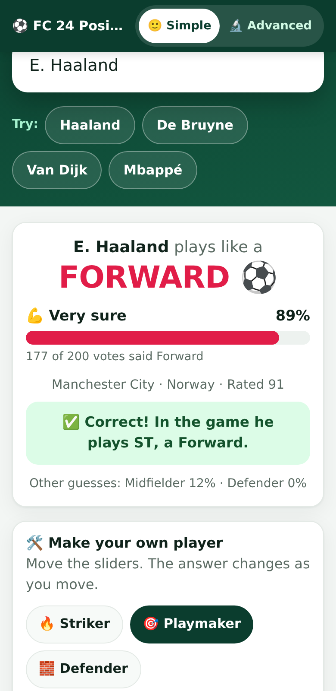
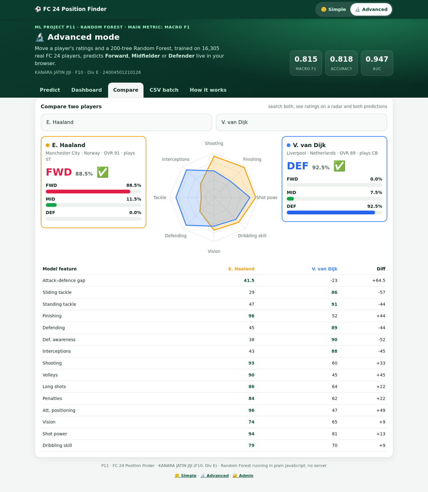
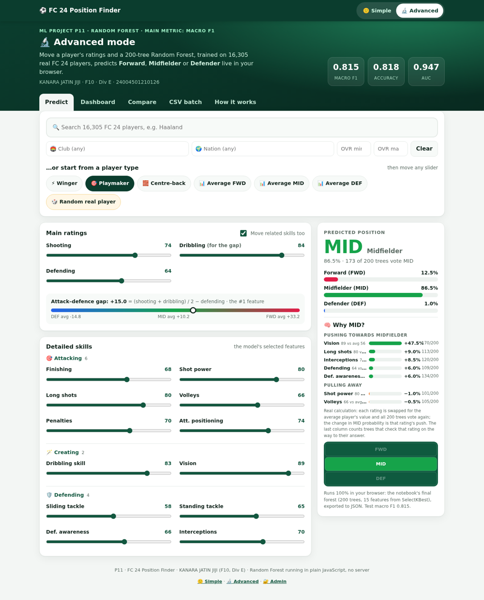
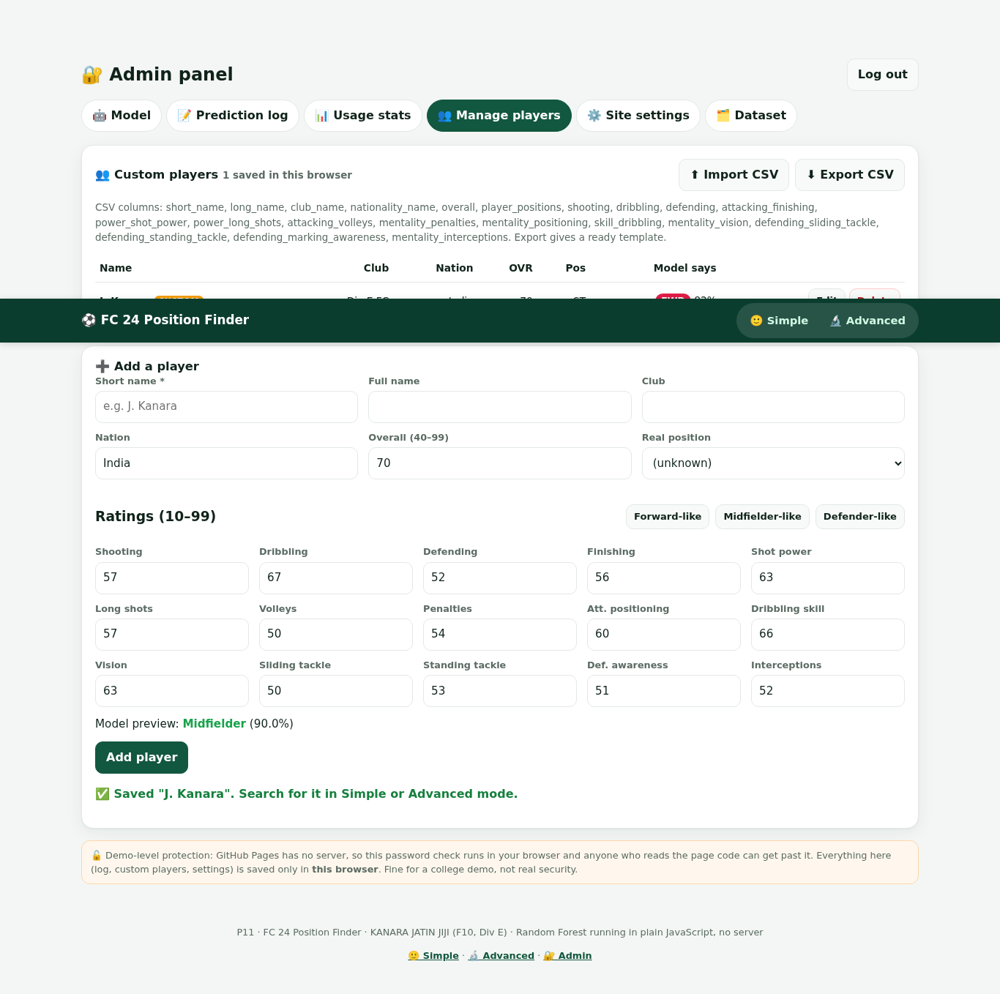

# ⚽ FC 24 Position Finder (P11)

**Forward, midfielder or defender? A Random Forest decides from a player's EA Sports FC 24 ratings.**

KANARA JATIN JIJI · Roll No. F10 · Div E · Enrollment No. 24004501210126

[](https://github.com/Jatinkanara21/FC_26/actions/workflows/train-test.yml)
[](https://colab.research.google.com/github/Jatinkanara21/FC_26/blob/main/F10_P11_Jatin.ipynb)
[](https://Jatinkanara21.github.io/FC_26/)
[](https://share.streamlit.io/)

## Live demo
- **Web app (runs in the browser, no server):** `https://Jatinkanara21.github.io/FC_26/` once GitHub Pages is on (see below)
- Preview copy: https://fc24-position-finder.sites.tab.bot/ · Admin: https://fc24-position-finder.sites.tab.bot/#admin

| 🙂 Simple mode (phone) | 🔬 Advanced: compare |
|---|---|
|  |  |

| 🔬 Advanced: predict + why | 🔐 Admin: manage players |
|---|---|
|  |  |

## Three parts: Simple, Advanced, Admin

### 🙂 Simple mode (the default page, for any football fan)
- One big search box, **"Type a player name"** (all 16,305 FC 24 outfield players, plus custom players).
- One big answer: **"E. Haaland plays like a FORWARD ⚽"**, with a confidence bar in plain words: *Very sure* (75%+), *Fairly sure* (55–75%), *Not sure*.
- Real vs predicted: **✅ Correct!** or **❌ Not this time**, with the player's real in-game position.
- **Make your own player:** 4 friendly sliders: 🥅 Shooting, 🎯 Passing, 🪄 Dribbling, 🛡️ Defending. Each one honestly drives the real model features:

  | Simple slider | Real model features it sets |
  |---|---|
  | 🥅 Shooting | `shooting` + finishing, shot power, long shots, volleys, penalties, attacking positioning |
  | 🎯 Passing | `mentality_vision` (the only passing-type rating SelectKBest kept) |
  | 🪄 Dribbling | `dribbling` (used in `attack_defence_gap`) + dribbling skill |
  | 🛡️ Defending | `defending` + sliding tackle, standing tackle, defensive awareness, interceptions |

  Each detailed rating = `round(a + b × slider)`, where `a, b` is a straight-line (least-squares) fit of that rating on its main stat over all 16,305 players (`simple_map.py`). `attack_defence_gap` is then computed exactly as in the notebook.
  **Speed and Strength are not sliders on purpose:** `pace` and `physic` were not selected by `SelectKBest(k=15)`, so they cannot change the prediction, and the page says so.
- "🔬 Advanced" inside the section shows the exact 15 numbers sent to the model, with a button to edit them in Advanced mode.
- A one-line "How it works" in plain English. No F1/AUC jargon.

### 🔬 Advanced mode (toggle at the top)
- **Predict:** 15 exact feature sliders, presets, class probabilities, the 200 trees' votes, player search with **filters by club, nation and overall (min/max)**.
- **🧠 Why this prediction:** real calculations on the same 200 trees. For each rating, the page swaps it for the average player's value, lets all 200 trees vote again and shows how much the predicted class's probability changes (pushing towards / pulling away). It also shows how many trees test that rating on this player's decision path.
- **Compare:** 2 players side by side: radar chart of 8 key ratings, both predictions with probabilities and ✅/❌, and a table of all 15 features.
- **Dashboard:** comparison table of all 7 settings, macro F1 chart, confusion matrix, ROC curves, feature importance, dataset stats.
- **CSV batch:** upload `male_players.csv` and every player is predicted on your own device.

### 🔐 Admin panel (`#admin`, link in the footer)
- **Model info:** settings, metrics, export date, the 15 features with importance and KBest scores.
- **Prediction log:** predictions made in this browser → export CSV / clear.
- **Usage stats:** predictions by class, mode/source and recent activity.
- **Manage players:** add / edit / delete custom players; import / export CSV.
- **Site settings:** app title, default mode, theme, announcement banner and demo password configuration.
- **Dataset overview:** row counts, train/test split, class balance and missing values.

**Admin setup:** No known default password is shipped. For a local/demo setup, calculate a SHA-256 hash with `python -c "import hashlib; print(hashlib.sha256(b'YOUR_STRONG_PASSWORD').hexdigest())"` and put it in `docs/config.js` as `adminPasswordSha256`.

> ⚠️ **Security boundary:** the GitHub Pages admin gate is client-side and can be bypassed; localStorage data belongs to one browser/device and is not shared or backed up. Do not use this panel for private data or production administration. For real security, use server-side authentication, server-enforced authorization, and a database. Streamlit requires `st.secrets["ADMIN_PASSWORD"]`; there is no hard-coded fallback password.

## Results (held-out test set, 3,261 players)

The model-selection method was corrected: the data is split first; fold-specific median imputation and supervised feature selection are fitted inside each cross-validation fold; and the seven configurations are selected using 3-fold stratified cross-validation on the training split only. The held-out test split is excluded from preprocessing and model selection and is used for final reporting only.

| Setting | Accuracy | Precision | Recall | **Macro F1** | Specificity | AUC | CV Macro F1 |
|---|---:|---:|---:|---:|---:|---:|---:|
| Baseline | 0.813 | 0.812 | 0.809 | **0.811** | 0.902 | 0.945 | 0.819 ± 0.003 |
| n_estimators=50 | 0.810 | 0.808 | 0.808 | **0.808** | 0.901 | 0.943 | 0.818 ± 0.005 |
| n_estimators=100 | 0.813 | 0.812 | 0.809 | **0.811** | 0.902 | 0.945 | 0.819 ± 0.003 |
| n_estimators=200 | 0.818 | 0.818 | 0.813 | **0.815** | 0.904 | 0.947 | 0.821 ± 0.005 |
| max_depth=None | 0.813 | 0.812 | 0.809 | **0.811** | 0.902 | 0.945 | 0.819 ± 0.003 |
| max_depth=5 | 0.782 | 0.778 | 0.784 | **0.781** | 0.886 | 0.928 | 0.790 ± 0.003 |
| max_depth=10 | 0.812 | 0.813 | 0.807 | **0.810** | 0.901 | 0.943 | 0.816 ± 0.002 |

**Selected configuration:** n_estimators=200 (selected by training CV macro F1 0.8213). Held-out test macro F1 **0.8152**, accuracy **0.8185**, AUC **0.9466**.

**Export parity:** the packed browser model matches scikit-learn probabilities on all 3,261 test rows (100% matching predictions; maximum probability difference 0). The CI test independently checks 300 reference rows.

## Method (the guide's 13 steps)
1. Libraries + title · 2. Load `male_players.csv`, keep `fifa_version == 24` (18,350 × 109) · 3. info / describe / nulls / duplicates + data dictionary
4. Target from the first entry of `player_positions`: FWD = ST, CF, LW, RW, LF, RF · MID = CM, CDM, CAM, LM, RM · DEF = CB, LB, RB, LWB, RWB; goalkeepers dropped → MID 6,673 · DEF 6,174 · FWD 3,458 (imbalanced)
5. Clean: duplicates, IDs, names, money and leaking columns dropped; median / mode fill · 6. EDA + 5 insights
7. New feature `attack_defence_gap = (shooting + dribbling)/2 − defending`, one-hot · 8. Stratified 80/20 split, `random_state=42`; fit `SelectKBest(f_classif, k=15)` on training data only
9. `evaluate()` (accuracy, macro precision / recall / F1, specificity, AUC ovr), baseline · 10. n_estimators 50/100/200, max_depth None/5/10, feature importance, forest vs one tree
11. Compare candidates with 3-fold stratified CV on training data; select by **CV macro F1**, report final held-out test metrics · 12. 3 new inputs · 13. Conclusion

## Improvements and verification

See [`IMPROVEMENTS.md`](IMPROVEMENTS.md) for the fixes applied, verified test results, corrected evaluation methodology, security boundaries, and deployment steps that require access to the GitHub/Streamlit accounts. The notebook now includes an evaluation note: use `train.py` as the canonical leakage-safe pipeline for final metrics.

## Files
| File | What it is |
|---|---|
| `F10_P11_Jatin.ipynb` | The notebook (13 steps, runs top to bottom) |
| `F10_P11_Report.pdf` | 5-page report |
| `VIVA.md` | Viva questions with my answers and numbers |
| `train.py` | Same pipeline as the notebook; trains, prints the table, exports the model for the web app |
| `app.py` | Streamlit version (Simple / Advanced radio, Admin sidebar, player search, sliders, CSV upload, dashboard, compare) |
| `simple_map.py` | Builds the Simple-mode slider mapping, the dataset overview and the sklearn reference for the Simple-mode test |
| `docs/` | The web app (GitHub Pages): `index.html`, `app.js` (model + advanced), `extra.js` (simple, compare, why, admin), `config.js` (admin password hash, defaults), `style.css`, `data/` |
| `data/fc24_players.csv` | The 18,350 FC 24 rows (`fifa_version == 24`) of Kaggle's `male_players.csv`, all 109 columns (10 MB) |
| `tests/` | Node tests: browser model == scikit-learn, Simple-slider mapping valid and == scikit-learn, admin hash, notebook inputs, site files |
| `.github/workflows/train-test.yml` | On every push: install, `python train.py`, `python simple_map.py`, run the tests (green tick) |

## Run it
**Colab:** click the badge, then run all. The notebook looks for `male_players.csv`, then `data/fc24_players.csv`. In Colab, either upload Kaggle's `male_players.csv` or run
`!wget -q https://raw.githubusercontent.com/Jatinkanara21/FC_26/main/data/fc24_players.csv`

**Locally:**
```bash
pip install -r requirements.txt
python train.py              # retrain + re-export docs/data/* (prints the comparison table)
python simple_map.py         # Simple-mode slider mapping + dataset overview + test reference
node --test tests/test_site.test.js
streamlit run app.py         # Streamlit app
```
Open `docs/index.html` in a browser to use the web app offline. It works from disk; no server is needed.

**Full Kaggle data:** download `male_players.csv` from https://www.kaggle.com/datasets/stefanoleone992/ea-sports-fc-24-complete-player-dataset and run `python train.py --data male_players.csv`.

## Deploy
- **GitHub Pages:** Settings → Pages → Source: *Deploy from a branch* → Branch `main`, folder `/docs` → Save. The link appears there after about a minute: `https://Jatinkanara21.github.io/FC_26/`.
- **Streamlit Community Cloud:** share.streamlit.io → *Create app* → pick this repo, branch `main`, main file `app.py` → *Deploy*. The first load trains the model, which takes about 20 s.

## How the browser runs the forest
`train.py` writes every tree in pre-order (one byte per node: the feature index, or `128 + class` for a leaf, then the split threshold), gzips it and stores it as base64 in `docs/data/model_data_*.js` (~1 MB for 200 trees). `app.js` unpacks it with the browser's built-in `DecompressionStream` and, for a player, walks all 200 trees (`x[feature] <= threshold` → left, else right) and averages the leaf votes, exactly like scikit-learn's `predict_proba`.
"# FC_26" 


## Secure admin backend (new)

The static GitHub Pages admin has been disabled because client-side authentication cannot protect data. A server-backed portal is provided at `/admin/` when running the Node server. It uses bcrypt password verification, server-side SQLite sessions, rate-limited login, protected API routes, and SQLite persistence for custom players, site settings, and prediction logs.

- Read [SECURE_ADMIN.md](SECURE_ADMIN.md) before deploying.
- Local setup: `npm install`, set `ADMIN_USERNAME`, `ADMIN_PASSWORD_HASH`, and a random `SESSION_SECRET`, then run `npm start`.
- Hosting: `render.yaml` is a starting point for a Node service with a persistent disk. Set secrets in the host dashboard; never commit real credentials.
- GitHub Pages remains a public static demo and cannot host the protected admin backend. Deploy the Node service to use secure admin features.
